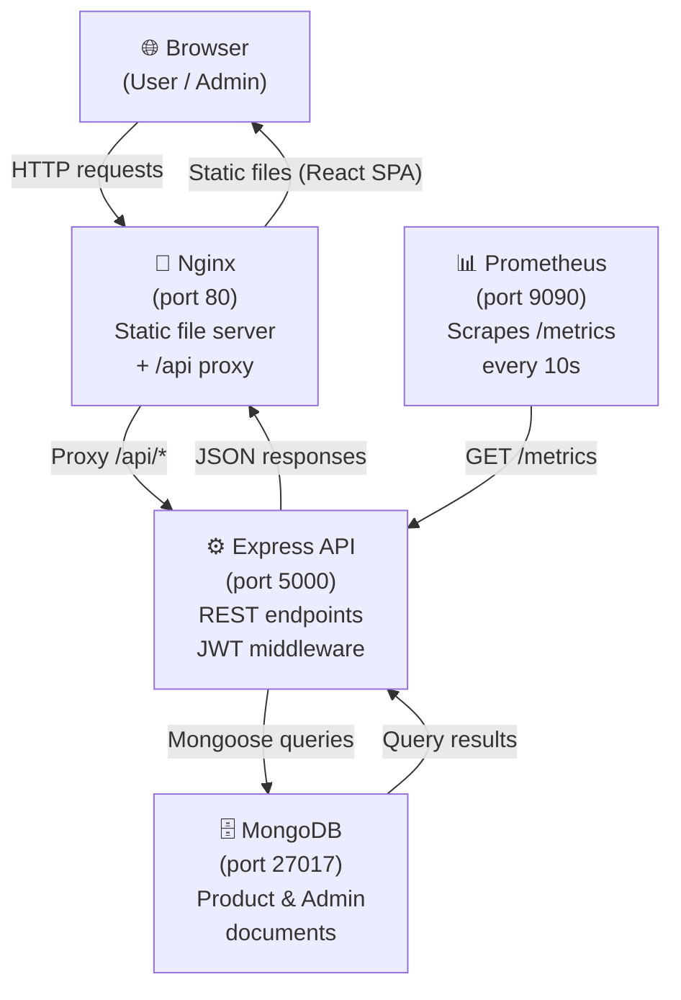
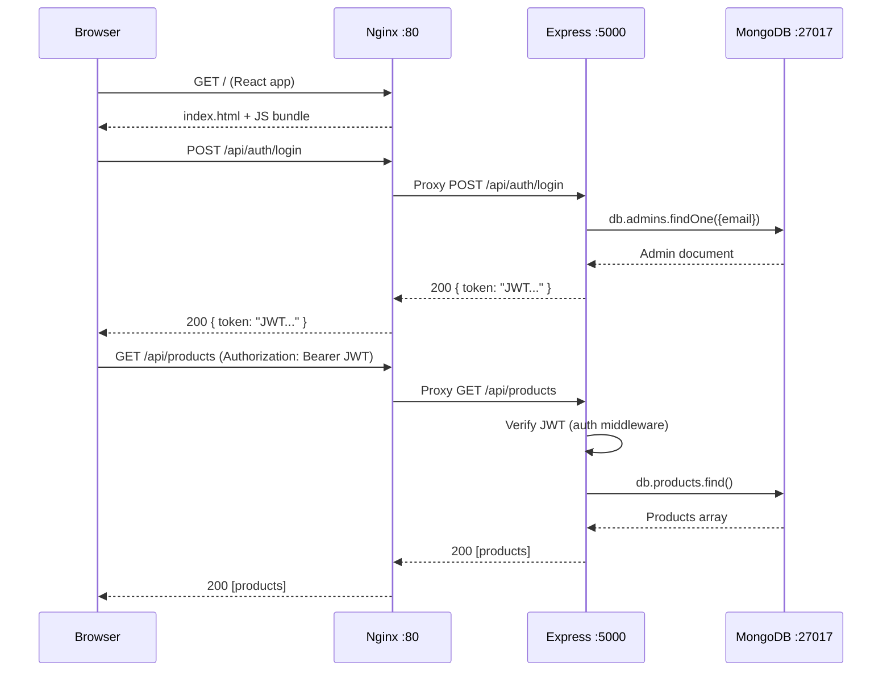
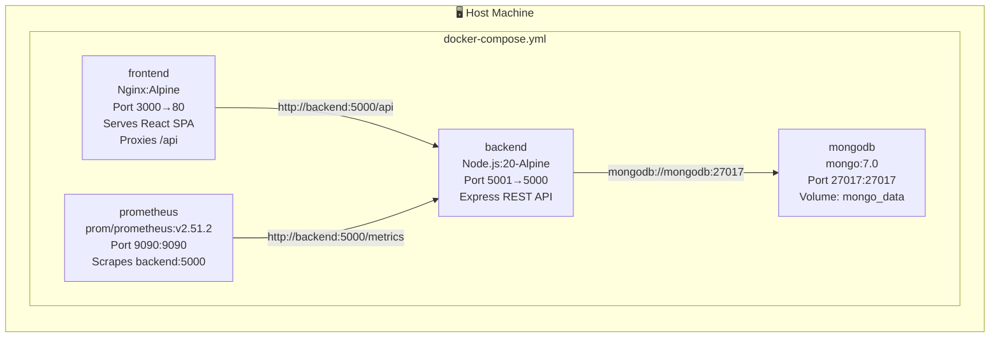
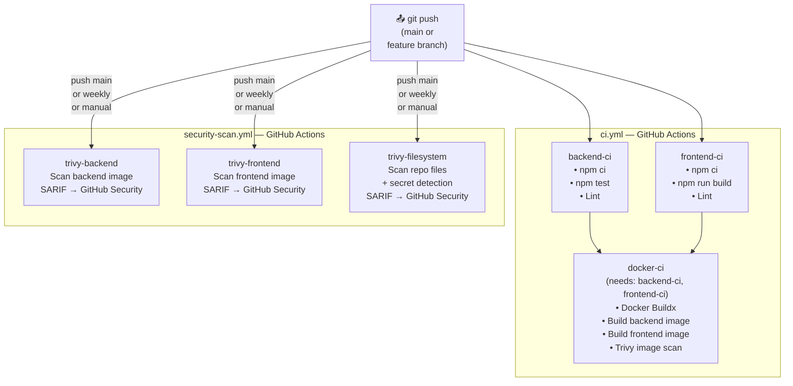
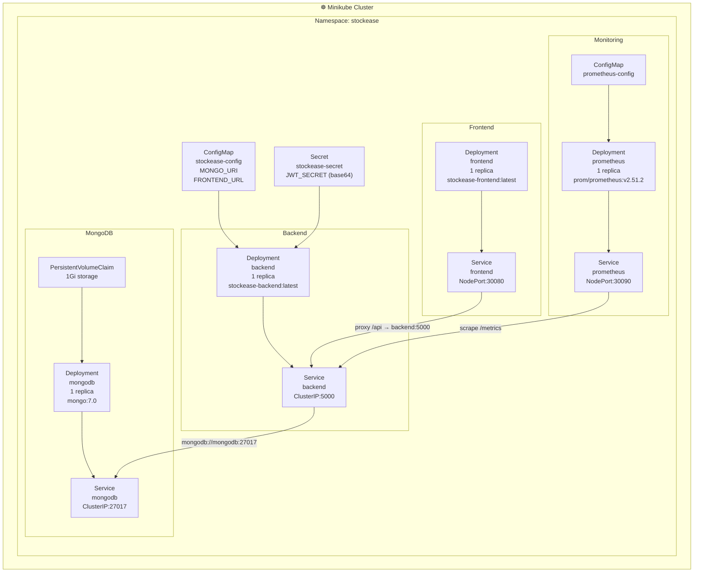
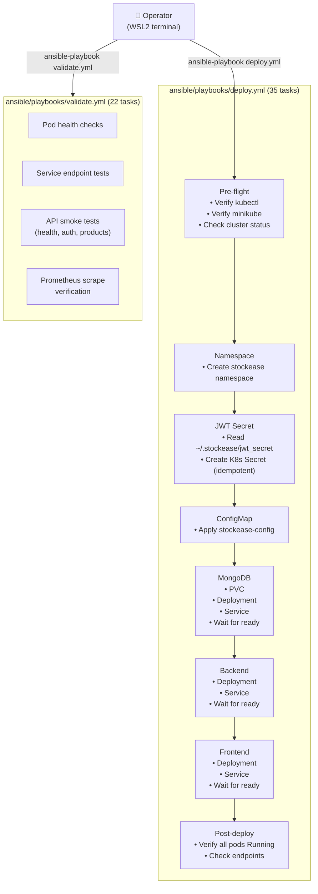
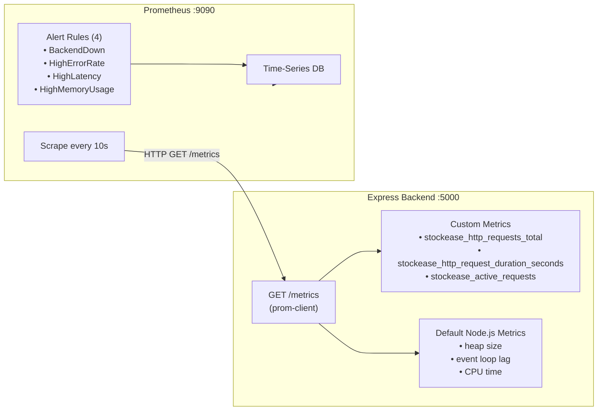
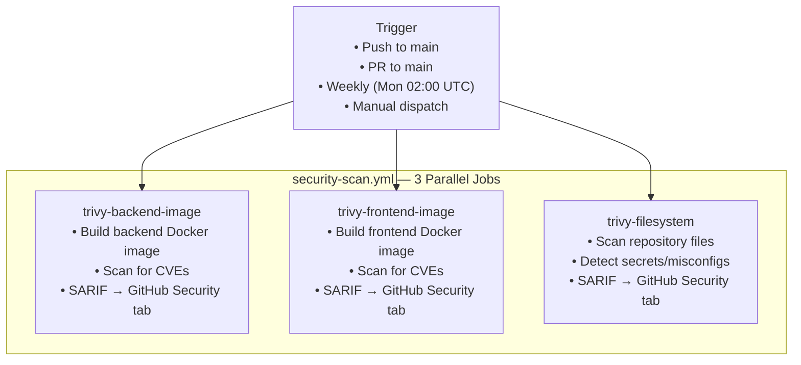
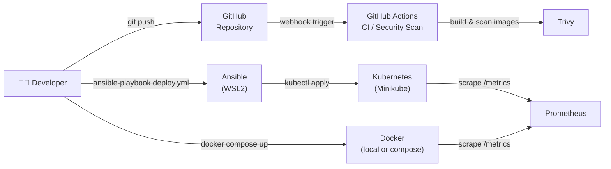

# StockEase – Architecture Reference

> **University DevOps Capstone Project**  
> Version: Final (Phase 8) | November 2026

This document describes the complete technical architecture of StockEase across all eight implemented phases, including application design, container topology, CI/CD pipeline, Kubernetes deployment, Ansible automation, and observability stack.

---

## 1. Application Architecture



---

## 2. API Request Flow



---

## 3. Docker Compose Container Topology



**Network:** All services share the `stockease-network` bridge network.  
**Volumes:** `mongo_data` persists MongoDB data across restarts.  
**Environment:** Configured via `.env` (copied from `.env.example`).

---

## 4. GitHub Actions CI/CD Pipeline



---

## 5. Kubernetes Deployment Architecture



**Access URLs (Minikube):**
- Frontend: `minikube service frontend -n stockease` → NodePort 30080
- Prometheus: `minikube service prometheus -n stockease` → NodePort 30090

---

## 6. Ansible Automation Flow



**Idempotency:** Second playbook run achieves `ok=35 changed=0` — JWT secret is read from `~/.stockease/jwt_secret` (outside the repository) and base64-encoded in the `data:` field of the K8s Secret resource to prevent spurious updates.

---

## 7. Monitoring and Observability



**Key PromQL queries:**
```promql
rate(stockease_http_requests_total[5m])
histogram_quantile(0.95, rate(stockease_http_request_duration_seconds_bucket[5m]))
stockease_active_requests
up{job="stockease-backend"}
```

---

## 8. Security Scanning (Trivy)



**Suppression:** `.trivyignore` in `monitoring/security/` suppresses accepted/known CVEs with justification comments.

---

## 9. Data Flow Summary



---

*Architecture document prepared by the StockEase Project Team — November 2026*
